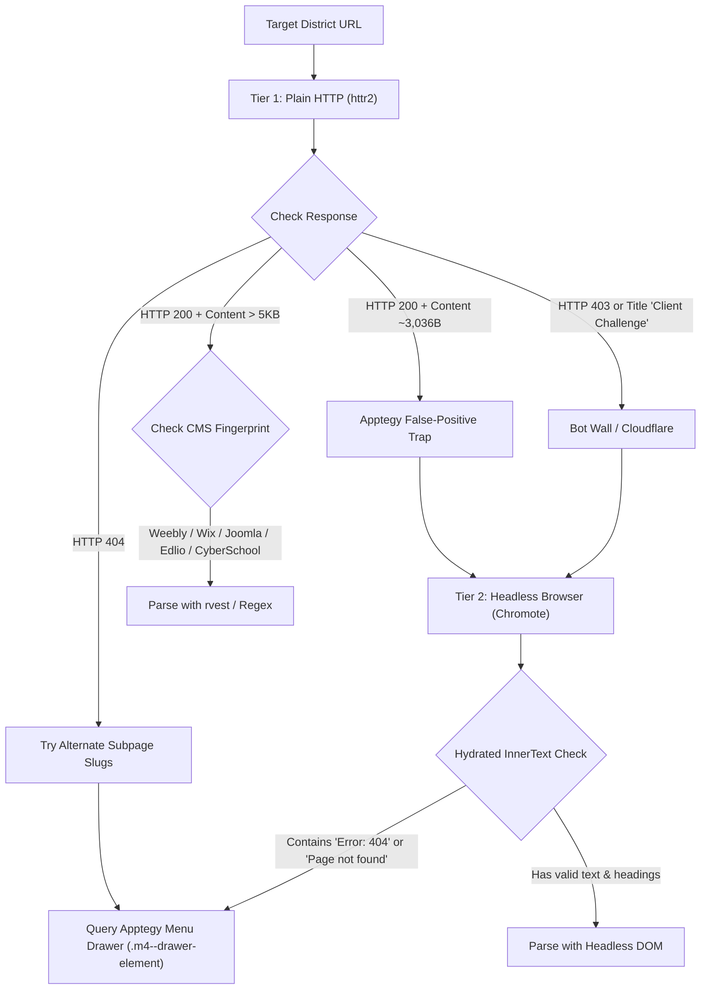

# District Scraper Tool Notes & Architecture Plan

This document synthesizes findings, platform heuristics, alternate viewing methods, and the architectural design for a dedicated `/district-scraper` command-line and interactive tool for the Montana Education Jobs Dashboard.

---

## 1. Vision & Purpose of `/district-scraper`

### Problem
- Finding, triaging, and writing scrapers for Montana's 150+ school districts is labor-intensive and burns expensive LLM context tokens when done entirely via manual browsing and reasoning.
- Districts use a wide variety of CMSs (Apptegy, CyberSchool, Edlio, Frontline/AppliTrack, RedRover, Submittable, Joomla, Weebly, Wix, Google Sites, WordPress) with wildly different DOM structures.
- Several CMSs exhibit subtle deceptive behavior (e.g., Apptegy's 3,036-byte SSR skeleton that returns HTTP 200 for 404 pages, or Cloudflare/Apptegy "Client Challenge" bot walls).

### Goal
Provide a scripted CLI / slash-command tool (`Rscript scripts/district_scraper.R <district-name>` or `/district-scraper <district-name>`) that:
1. **Automates Discovery & Resolution:** Resolves real Montana district URLs without tripping on out-of-state namesake collisions.
2. **Fingerprints CMS & Renders Reliably:** Uses tiered fetching (`httr2` plain HTTP $\to$ Chromote headless browser fallback) to bypass anti-bot challenges and Nuxt/SPA hydration issues.
3. **Extracts Live Postings & Markers:** Heuristically detects job lists, category headings, PDF vacancy notices, or Submittable/AppliTrack widgets.
4. **Generates Boilerplate Code (Zero LLM Tokens):** Emits verbatim dated fixtures, test cases, and parser functions automatically, leaving human/LLM review only for final quality sign-off.

---

## 2. Search Query Heuristics & Platform Traps

District searches often fail or return false positives due to identical town/school names across the United States. Through systematic testing across Montana's backlog, the following query patterns have proven most reliable:

### Proven Search Query & Directory Lookup Formulas
| Goal | Method / Formula | Why It Works |
|---|---|---|
| **OPI Jobs for Teachers Details** | `apps.opi.mt.gov/MTJobsForTeachers/frmJobDetailsPublic.aspx` | Every posting detail page explicitly publishes a `Web Site:` field (e.g. `colstrippublicschools.org`), plus verified `District:`, `School:`, and contact phone/address. |
| **OPI Statewide Directory** | `apps.opi.mt.gov/SchoolDirectory/frmdirectorydistrictpdf.aspx` | Live 325-page daily PDF from OPI containing all districts across 56 counties with `Trustee Website:` and superintendent email domains (`@<district>.k12.mt.us`). |
| **District Website Search** | `"<District Name> School" "Montana" OR "<County> County"` | Anchors to Montana and eliminates out-of-state duplicates when not in OPI. |
| **K12 MT Subdomain** | `site:*.k12.mt.us "<District Name>"` | Hits official State of Montana school district subdomains directly. |
| **Submittable Boards** | `site:submittable.com/submit "<District Name>" "School" "MT"` | Catches districts using Submittable (e.g. West Valley). |
| **Frontline / AppliTrack** | `site:applitrack.com "<District Name>" "MT"` | Direct hit on Frontline portals (e.g. Harlem). |
| **RedRover K12** | `site:redroverk12.com "Montana" "<District Name>"` | Direct hit on RedRover portals (e.g. Hamilton, St. Ignatius). |

### Out-of-State Collision Catalog
Always cross-check street address, ZIP code (59xxx), phone area code (406), and county before accepting a URL:
- **Luther:** `lutherlions.org` is Luther, **OK**. Real Montana site is `lutherschool.org` (Carbon County).
- **Avon:** Resolves to Avon-by-the-Sea, **NJ**. Montana Avon is a 1-school district in Powell County (`avon.k12.mt.us`).
- **Pine Grove:** `pgasd.com` is Pine Grove Area School District, **PA**. Montana Pine Grove is Rosebud County.
- **Bynum:** `bynumschool.org` is Bynum, **TX**. Montana Bynum is Teton County (`bynum.k12.mt.us`).
- **Swan Valley:** `swanvalleyschools.com` is Saginaw, **MI**. Real Montana site is `swanvalleyelementary.org` (Missoula County).
- **Marion:** `marionschools.org` is Jasper, **TN**. Montana Marion is Flathead County.
- **Broadus:** Avoid Broadus, TX results; real site is `broadus.net` (Powder River County).

---

## 3. CMS Fingerprinting & Alternate Viewing Methods

When a scraper or simple HTTP request fails, trying an alternate viewing method is essential:



### 1. Apptegy (Thrillshare / Nuxt SPA)
- **The 3,036-Byte False-Positive Trap:** Apptegy's Nuxt server responds with HTTP 200 and a generic ~3,036-byte HTML skeleton even for non-existent pages! Plain HTTP clients think the page exists.
  - *Viewing Method:* Render via Chromote and evaluate `document.body.innerText`. If text contains `"Error: 404"` or `"Page not found"`, the page does not exist.
- **Bot Wall / Client Challenge:** Some Apptegy domains return a challenge page (`<title>Client Challenge</title>`).
  - *Viewing Method:* Render in headless Chromium (Chromote); let the 4-second JS challenge resolve and hydrate.
- **Hidden Job URL (Menu Drawer Recovery):** Districts often place their job board on an unexpected subpage (e.g. CJI at `/page/employmentcji`, Hot Springs at `/page/district-employment`, Frenchtown at `/page/our-district1`).
  - *Viewing Method:* In Chromote, open the mobile/desktop menu drawer (`aria-label="Open Menu"` or `.m4--drawer-element`) and scrape all internal `a[href^="/page/"]` links matching `/employ|job|career|work/i`.

### 2. Weebly CMS
- **Characteristics:** Static or server-rendered HTML. Clean `#wsite-content` container.
- **Structure:** Openings typically sit in `<h2 class="wsite-content-title">` or `<h3>` (e.g. Swan Valley Elementary).
- **Viewing Method:** Plain HTTP (`httr2::request()`) is 100% reliable and fast.

### 3. Joomla CMS
- **Characteristics:** Document managers and categorized tables under `/documents` or `/index.php/documents`.
- **Structure:** File links sit in `.element-title a[href$=".pdf"]` or `table` rows (e.g. Luther School, Belfry).
- **Viewing Method:** Plain HTTP; extract PDF links and cleanse anchor text (strip trailing `.pdf`, file sizes, and download stamps).

### 4. Submittable Portals
- **Characteristics:** Submittable embedded forms hosted at `<district>.submittable.com/submit`.
- **Structure:** Titles sit cleanly in `.header-3.word-wrap a` (e.g. West Valley School District #1).
- **Viewing Method:** Plain HTTP; parse `.header-3 a`. Extremely reliable, no bot blocks.

### 5. Edlio CMS
- **Characteristics:** Hosted district portal, standard `/apps/jobs/` or `/apps/pages/` route.
- **Structure:** `.list-item` with `.app-job-title` or `a.app-job-link` (e.g. Whitehall).
- **Viewing Method:** Plain HTTP with standard User-Agent.

### 6. Published Google Sites
- **Characteristics:** Hosted on `sites.google.com` or custom domain pointed to Google Sites.
- **Structure:** Openings formatted in `h2`, `h3`, or `div[role="heading"]` (e.g. Broadus).
- **Viewing Method:** Plain HTTP works cleanly.

---

## 4. Architecture Plan for the `/district-scraper` Tool

The `/district-scraper` tool should be implemented as an R script (`scripts/district_scraper.R`) callable directly or via slash command.

### Pipeline Stages

```
1. INPUT: District Name (e.g. "Frenchtown")
   │
2. RESOLUTION ENGINE:
   ├─ Check k12_district_registry.csv for existing record
   ├─ Query OPI Directory (rptDirectoryDistrictPDF.pdf / OPI Jobs for Teachers detail page)
   │    └─ Extract exact official domain from "Trustee Website:" or superintendent email domain
   ├─ If unlisted in OPI, probe <slug>.k12.mt.us, then fallback to targeted Montana web search
   └─ Validate Montana address / 406 phone / county match
   │
3. PROBING & TIERED FETCHER:
   ├─ Attempt httr2 HTTP GET
   ├─ Inspect Content-Type, Content-Length, and Response HTML
   ├─ Detect CMS signatures (Apptegy, Edlio, CyberSchool, Joomla, Weebly, Wix, Submittable)
   └─ If Apptegy / SPA / Challenge detected:
        └─ Spawn Chromote session -> wait for DOM hydration -> dump innerText & innerHTML
   │
4. HEURISTIC PARSER & AUDITOR:
   ├─ Scan DOM for known job patterns:
   │    - ALL-CAPS section headers (Apptegy)
   │    - Heading tags (h2/h3) with job keywords
   │    - Table rows with job/title columns
   │    - Submittable / AppliTrack / RedRover item selectors
   │    - Downloadable PDF vacancy notices
   └─ Filter false positives (standing job descriptions, evergreen application forms)
   │
5. ZERO-TOKEN CODE GENERATOR:
   ├─ Save dated verbatim fixture: tests/testthat/fixtures/<slug>_<source>_<YYYY-MM-DD>.<ext>
   ├─ Generate R function: fetch_<slug>_postings() & parse_<slug>_postings()
   ├─ Append unit tests in tests/testthat/test-misc-district-scrapers.R
   ├─ Generate row for k12_district_registry.csv (with geocoded lat/long)
   ├─ Add domain to .github/copilot-allowlist.txt
   └─ Add scrape execution block to Mt_ED_Jobs.Rmd
   │
6. VERIFICATION:
   └─ Run automated testthat suite on the newly generated test
```

### Heuristic Job Title Classifier (Regex Patterns)
To save LLM tokens, the script can classify whether a text block is a genuine job posting using regex:
- **Strong Positive Signals:**
  - `(?i)\b(teacher|para|paraprofessional|custodian|bus driver|cook|aide|principal|superintendent|counselor|coach|secretary|special education|sped)\b`
  - `(?i)\b(certified|classified|extracurricular|extra-curricular|openings|vacancies|positions available)\b`
- **Strong Negative / Exclude Signals:**
  - `(?i)\b(how to apply|application packet|equal opportunity employer|board of trustees|student handbook|lunch menu|supply list)\b`
  - `(?i)\b(closed|filled|deadline has passed)\b`

---

## 5. Catalog of Tested Backlog Districts & Status

| District | County | Real Platform | Status | Finding / Method Used |
|---|---|---|---|---|
| **West Valley #1** | Flathead | Submittable (`westvalleyschool.submittable.com/submit`) | ✅ **Adopted (Batch 5)** | Plain HTTP. Titles sit in `.header-3.word-wrap a`. 1 live posting. |
| **Luther School** | Carbon | Joomla (`lutherschool.org/index.php/documents`) | ✅ **Adopted (Batch 5)** | Plain HTTP. PDFs under document panel. 2 live postings. |
| **Swan Valley #3** | Missoula | Weebly (`swanvalleyelementary.org/careers.html`) | ✅ **Adopted (Batch 5)** | Plain HTTP. Titles in `#wsite-content h2`. 1 live posting. |
| **Hot Springs** | Sanders | Apptegy (`hssdmt.org/page/district-employment`) | ✅ **Adopted (Batch 5)** | Chromote headless DOM. ALL-CAPS category headers. 8 live postings. |
| **Whitehall** | Jefferson | Edlio (`whitehallschools.org/apps/jobs/`) | ✅ **Adopted (Batch 4)** | Plain HTTP. Titles in `.list-item`. 4 live postings. |
| **Broadus** | Powder River | Google Sites (`broadus.net/job-openings`) | ✅ **Adopted (Batch 4)** | Plain HTTP. Titles in `h3`. 4 live postings. |
| **Wibaux** | Wibaux | Wix (`wibauxschools.net/employment`) | ✅ **Adopted (Batch 4)** | Plain HTTP. Button link extraction. 1 live posting. |
| **Nashua** | Valley | CyberSchool (`nashua.k12.mt.us/District/Jobs/`) | ✅ **Adopted (Batch 3)** | Plain HTTP. Category headers. 7 live postings. |
| **Belfry** | Carbon | Joomla (`belfrybats.org/index.php/our-school/employment`) | ✅ **Adopted (Batch 2)** | Plain HTTP. Table parser (`table.uk-table`). 2 live postings. |
| **Harlem** | Blaine | AppliTrack (`applitrack.com/harlemhs/onlineapp/`) | ✅ **Adopted (Batch 2)** | Plain HTTP Frontline scraper. 8 live postings. |
| **Sweet Grass County HS** | Sweet Grass | Apptegy (`sgchs.com/page/employment`) | ✅ **Adopted (Batch 1)** | Chromote headless DOM. 5 live postings. |
| **Highwood Public Schools** | Chouteau | CyberSchool (`highwood.k12.mt.us/District/Jobs/`) | ✅ **Adopted (Batch 6)** | Plain HTTP. Titles sit in `.listItem_holder`. 4 live postings. |
| **Smith Valley #8** | Flathead | Google Sites (`smithvalleyschool.org/employment-opportunities`) | ✅ **Adopted (Batch 6)** | Plain HTTP. Titles under "Positions Available:" `h2`. 2 live postings. |
| **Moore Public Schools** | Fergus | Weebly (`mooreschoolmt.com/employment.html`) | ✅ **Adopted (Batch 6)** | Plain HTTP. Active posting with PDF advertisement link. 1 live posting. |
| **Cardwell Elementary** | Jefferson | Google Sites (`sites.google.com/cardwellschool.org/cougars/join-cardwell`) | ✅ **Adopted (Batch 6)** | Plain HTTP. Title under "Open Positions for the [year] school year:". 1 live posting. |
| **Boulder Elementary #7** | Jefferson | SchoolCMS (`bgs.k12.mt.us/employment`) | ✅ **Adopted (Batch 7)** | Plain HTTP. HTML widget under "Vacancy Announcements". 2 live postings. |
| **Jefferson High School #1** | Jefferson | eSchoolView (`jhs.k12.mt.us/EmploymentOpportunities.aspx`) | ✅ **Adopted (Batch 7)** | Plain HTTP. Structured job list under "For [year] School Year". 6 live postings. |
| **Sheridan Public Schools** | Madison | Google Sites (`sheridan.k12.mt.us/district/employment`) | ✅ **Adopted (Batch 7)** | Plain HTTP. Winter/spring coaching and substitute positions. 4 live postings. |
| **Lockwood School District** | Yellowstone | Edlio (`lockwoodschool.org/apps/pages/index.jsp?uREC_ID=409277&type=d`) | ✅ **Adopted (Batch 7)** | Plain HTTP. 8 live postings under "Lockwood Schools Open Positions" and "Athletic Coaching". |
| **Brockton School District** | Roosevelt | Plain HTML (`brockton.k12.mt.us/employment`) | ⚠️ **Drifted / Fix Planned** | Migrated from SchoolInSites to district site; format changed to `Position: ... Duties: ...`, causing 0 rows. |
| **Canyon Creek School** | Yellowstone | Edlio (`canyoncreekschool.org/apps/pages/index.jsp?uREC_ID=532741&type=d`) | Backlog (Group 2) | Two generic printable application PDFs only; recheck later. |
| **Pioneer School** | Yellowstone | SchoolCMS (`pioneerschool.us/41034_2`) | Backlog (Group 2) | Single standing substitute call only. |
| **Montana City ESD 27** | Jefferson | CyberSchool (`mtcityschool.net/District/Jobs/`) | Backlog (Group 2) | Current jobs list is empty. |
| **Circle Public Schools** | McCone | Weebly (`circleschools.org/employment-opportunities.html`) | Backlog (Group 2) | Generic application forms only. |
| **Whitewater School District** | Phillips | Plain HTML (`whitewater.k12.mt.us/employment`) | Backlog (Group 2) | Stated "currently fully staffed for 2025-2026". |
| **Plains K-12 #1** | Sanders | District site (`plainsschools.net/employment/`) | Backlog (Group 6) | Postings sit inside an embedded Google Drive folder (`1PLQRtQHAjWSZxlyn3kcWtEp1N7crZh-m`). |
| **Chester-Joplin-Inverness (CJI)** | Liberty | Apptegy (`cji.k12.mt.us/page/employmentcji`) | Backlog | Has a single combined PDF vacancy notice; monitor for discrete job titles. |
| **Frenchtown** | Missoula | Apptegy (`ftsd.org/page/our-district1`) | Backlog (Multi-page) | Major Class A district; positions spread across subpages; target for multi-page crawler. |
| **Medicine Lake #10** | Sheridan | Apptegy (`medicinelake.k12.mt.us`) | Backlog | Real site confirmed via Apptegy; has staff directory but no active job board. |
| **Basin School** | Jefferson | `basin.k12.mt.us` | Recheck | Reopened April 2026; official domain registered in State DNS, website under construction. |
| **Hellgate Elementary** | Missoula | Multi-page (`hellgate.k12.mt.us/our-district/employment`) | In Progress | Main page live in pilot; subpages need multi-page batch scraper. |
| **East Glacier Park** | Glacier | District site (`eastglacierschool.com/employment`) | Backlog | Generic staff application forms only. |
| **Clancy** | Jefferson | CyberSchool (`clancyschool.org/page/employment`) | Backlog | Empty CMS shell; no active vacancies. |
| **Harlowton** | Wheatland | Apptegy (`harlowton.k12.mt.us/page/employment`) | Backlog | Apptegy salary schedules posted, 0 active vacancies listed under Certified. |
